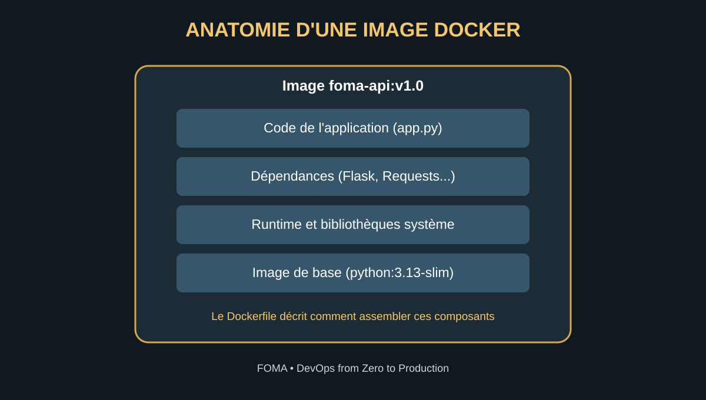
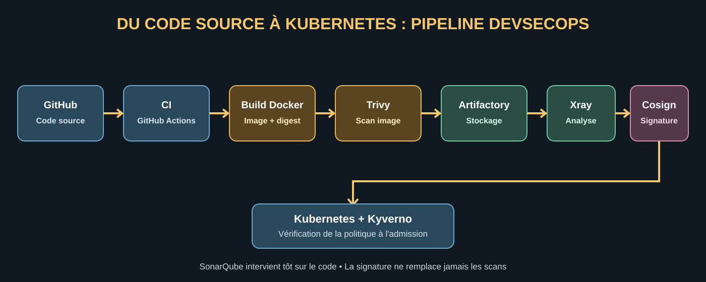
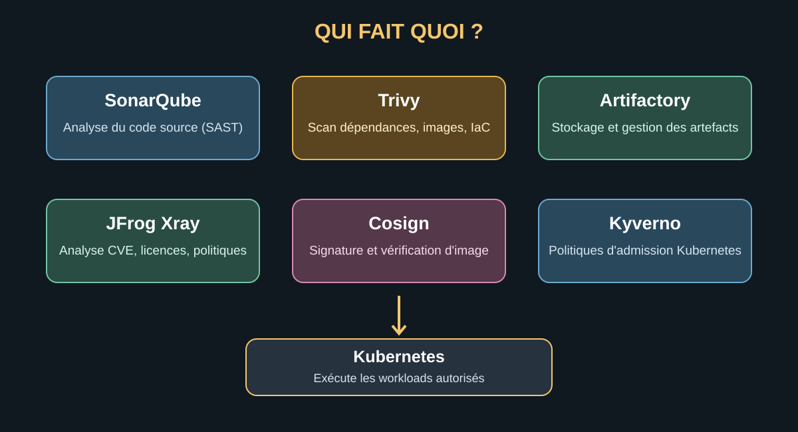

# Construction et sécurisation d'une image Docker
## Cours DevOps / DevSecOps — De l'application au déploiement sécurisé

**Formation :** Foundation of Mastering Automation (FOMA)  
**Formateur :** William Foma  
**Site :** https://www.foma.life

---

## Objectifs du cours

À la fin de ce cours, vous devez pouvoir expliquer :

- ce qu'est un artefact logiciel ;
- la différence entre code source, dépendance, image de base et image Docker ;
- le rôle du Dockerfile et les étapes d'un build ;
- comment les dépendances sont téléchargées et intégrées à une image ;
- la différence entre Docker Hub et JFrog Artifactory ;
- les rôles respectifs de SonarQube, Trivy, JFrog Xray, Cosign et Kyverno ;
- à quel moment l'image est scannée, stockée, signée, promue et déployée ;
- comment réagir lorsqu'une vulnérabilité est découverte après le déploiement.

> **Principe fondamental :** une image qui se construit correctement n'est pas nécessairement sûre. Il faut contrôler son contenu, maîtriser sa provenance, appliquer des politiques et vérifier ce qui est autorisé à entrer en production.


## Illustrations du cours

### 1. Anatomie d'une image Docker



Une image regroupe le runtime, les bibliothèques système, les dépendances et le code applicatif. Le Dockerfile décrit leur assemblage.

### 2. Chaîne CI/CD DevSecOps



Ce flux est un exemple de référence. L'ordre exact des scans, du push, de la signature et de la promotion dépend de l'architecture et des contrôles configurés.

### 3. Responsabilités des outils



Ces outils sont complémentaires : aucun ne remplace à lui seul l'ensemble des contrôles de sécurité.

---

# 1. Comprendre les artefacts

Un **artefact logiciel** est un résultat produit par une étape de construction ou de packaging d'un logiciel. Il peut être stocké, versionné, transféré et réutilisé dans les étapes suivantes.

Exemples :

- une image Docker ;
- un package Python (wheel) ;
- un package npm ;
- un fichier Java JAR ;
- un chart Helm ;
- une archive ZIP contenant une application.

### Exemple : FOMA API

Imaginons une API développée en Python. Le projet contient :

- le code de l'application ;
- un fichier `requirements.txt` ;
- un Dockerfile ;
- des fichiers de configuration non sensibles.

Après le build Docker, on obtient une image appelée `foma-api:v1.0`. Cette image est un artefact : elle regroupe le runtime et les composants nécessaires à l'exécution de l'application.

**À retenir :** le code source est ce que les développeurs écrivent ; l'image Docker est un artefact construit à partir du code, du Dockerfile, de l'image de base et des dépendances.

---

# 2. Comprendre les images de base

Le Dockerfile commence souvent par une instruction `FROM`. Elle indique l'image de base sur laquelle construire l'image de l'application.

Exemples :

- `python:3.13-slim` : runtime Python sur une base Debian allégée ;
- `python:3.13-alpine` : runtime Python sur Alpine Linux ;
- `node:22-slim` : runtime Node.js sur une base Debian allégée.

Le choix dépend de la technologie de l'application, de la compatibilité des dépendances, des besoins système, de la maintenance et de la politique de sécurité de l'entreprise.

### Surface d'attaque

La surface d'attaque correspond aux composants, interfaces et fonctionnalités qui pourraient être exploités par un attaquant. Réduire les composants inutiles peut réduire cette surface, mais une image Alpine n'est pas automatiquement plus sûre qu'une image Debian ou Ubuntu. Il faut tenir compte des vulnérabilités connues, des mises à jour, de la compatibilité et de la maintenance.

---

# 3. Dockerfile et dépendances : d'où viennent les packages ?

Prenons une application Python qui utilise Flask et Requests.

- **Python** est le langage et son runtime.
- **Flask** est un framework Python.
- **Requests** est une bibliothèque Python.
- **PyPI** est le dépôt public de packages Python.
- **requirements.txt** déclare les dépendances Python du projet.
- **Dockerfile** décrit comment construire l'image.

Exemple de fichier `requirements.txt` :

```text
Flask==3.1.0
requests==2.32.3
```

Exemple de Dockerfile pédagogique :

```dockerfile
FROM python:3.13-slim

WORKDIR /app

COPY requirements.txt .

RUN pip install --no-cache-dir -r requirements.txt

COPY . .

EXPOSE 5000

CMD ["python", "app.py"]
```

Pendant le build, la commande `pip install` télécharge les packages depuis PyPI, ou depuis un dépôt privé configuré par l'entreprise, puis les installe dans l'environnement de l'image.

Dans une chaîne de production, il est préférable de verrouiller les versions et, lorsque c'est possible, les empreintes des dépendances. On peut aussi utiliser un dépôt proxy/remote Artifactory pour contrôler et mettre en cache les dépendances externes.

> Les versions indiquées ici sont des exemples pédagogiques. Pour un projet réel, vérifier les versions maintenues et les avis de sécurité avant de les adopter.

---

# 4. Construire et taguer une image Docker

Depuis le répertoire du projet :

```bash
docker build -t foma-api:v1.0 .
```

Explication :

- `docker build` lance la construction ;
- `-t` attribue un nom et un tag ;
- `foma-api` est le nom de l'image ;
- `v1.0` est le tag ;
- `.` indique le contexte de build.

Pour afficher les images locales :

```bash
docker images
```

Le tag est une étiquette pratique, mais il peut être déplacé ou réutilisé. Pour identifier exactement le contenu d'une image, on utilise son **digest** (par exemple `sha256:...`). En production, privilégier les références immuables par digest pour les opérations critiques de promotion et de déploiement.

---

# 5. Docker Hub et JFrog Artifactory : quelle différence ?

## Docker Hub

Docker Hub est un registre de conteneurs qui permet notamment de stocker, partager et distribuer des images Docker, publiques ou privées.

## JFrog Artifactory

Artifactory est un gestionnaire universel de dépôts d'artefacts. Il prend en charge de nombreux formats : images OCI/Docker, Maven, npm, PyPI, Helm et d'autres types de packages.

Il permet notamment :

- de centraliser les artefacts ;
- de gérer les dépôts et les permissions ;
- de mettre en cache ou proxyfier des dépôts externes ;
- de contrôler les flux de promotion entre environnements ;
- de s'intégrer avec JFrog Xray pour l'analyse de sécurité.

Docker Hub possède aussi des fonctions de sécurité, notamment Docker Scout. La différence n'est donc pas simplement « Docker Hub stocke, JFrog scanne ». Artifactory répond surtout à un besoin plus large de gestion centralisée des artefacts dans une organisation.

## Types de dépôts Artifactory

- **Local** : dépôt hébergé directement dans Artifactory par l'organisation.
- **Remote** : proxy/cache d'un dépôt externe, par exemple un registre ou dépôt public.
- **Virtual** : point d'accès qui regroupe plusieurs dépôts locaux et/ou remote sous une même adresse logique.

---

# 6. Les outils de sécurité et leurs responsabilités

Ces outils sont complémentaires. Ils ne réalisent pas tous le même contrôle.

## SonarQube — analyse du code source

SonarQube analyse le code pour identifier des problèmes de qualité et certaines vulnérabilités de sécurité. Il peut être utilisé dans le cadre du SAST (Static Application Security Testing).

Exemple : détecter une construction de requête SQL dangereuse dans le code.

SonarQube n'est pas un scanner universel de toutes les dépendances ou de toutes les images conteneur.

## Trivy — scanner polyvalent

Trivy peut analyser :

- les images conteneur ;
- les dépendances et fichiers de verrouillage ;
- les systèmes de fichiers ;
- certains fichiers de configuration Infrastructure as Code ;
- les secrets détectables.

Exemple : après le build, Trivy analyse l'image `foma-api:v1.0` et signale une bibliothèque système ou une dépendance Python associée à une CVE.

Trivy est un projet open source. Il peut être exécuté localement ou dans un pipeline CI.

## JFrog Xray — analyse de la supply chain et des artefacts

Xray s'intègre à l'écosystème JFrog et analyse les composants des artefacts indexés dans Artifactory. Il peut notamment détecter :

- des vulnérabilités connues (CVE) ;
- des problèmes de licences selon les règles configurées ;
- des risques dans les dépendances transitives ;
- des violations des politiques de l'organisation.

Xray peut réévaluer les artefacts indexés lorsque de nouvelles informations de vulnérabilité sont disponibles.

Il faut configurer l'indexation, les Watches et les Policies nécessaires. Un simple push dans Artifactory ne garantit pas à lui seul qu'un scan Xray est actif ni qu'un push sera bloqué.

## Cosign — signature et vérification

Cosign, de l'écosystème Sigstore, permet de signer des images conteneur et de vérifier leurs signatures. Il peut aussi être utilisé pour signer ou vérifier des attestations.

La signature prouve l'intégrité du contenu référencé et permet de vérifier l'identité qui a signé selon la configuration choisie. **Elle ne prouve pas, à elle seule, que l'image est exempte de vulnérabilités.**

## Kyverno — politiques d'admission Kubernetes

Kyverno est un moteur de politiques pour Kubernetes. Il peut appliquer des règles à l'admission des ressources, notamment vérifier que les images proviennent de registres autorisés et que leurs signatures sont valides selon une identité ou une clé approuvée.

- Cosign signe et fournit les moyens de vérifier la signature.
- Kyverno applique la politique de vérification au moment de l'admission.
- Kubernetes accepte ou refuse la ressource selon le résultat et les autres contrôles d'admission.

OPA Gatekeeper est une autre solution de politiques Kubernetes. Il s'appuie sur Open Policy Agent et le langage Rego. Kyverno et Gatekeeper sont des options alternatives dans de nombreuses architectures ; il n'est généralement pas nécessaire de déployer les deux pour appliquer les mêmes politiques.

---

# 7. La chaîne CI/CD : à quel moment intervient chaque outil ?

Voici un flux de référence possible pour une image Docker.

1. **Développement** : le développeur écrit le code, les fichiers de dépendances et le Dockerfile.
2. **Git** : le code est poussé dans GitHub.
3. **CI** : GitHub Actions déclenche le pipeline.
4. **SAST** : SonarQube analyse le code source.
5. **Analyse des dépendances** : Trivy peut examiner les fichiers de dépendances et de verrouillage.
6. **Build** : Docker construit l'image.
7. **Scan de l'image** : Trivy peut analyser l'image construite avant son push.
8. **Push** : l'image est envoyée vers un dépôt Docker local dans Artifactory.
9. **Analyse Xray** : si le dépôt est indexé et les règles configurées, Xray analyse l'artefact et évalue les Policies.
10. **Décision du pipeline** : le pipeline récupère le résultat Xray et échoue ou continue selon les seuils et règles de l'organisation.
11. **Signature** : après les contrôles requis, Cosign signe l'image identifiée par son digest.
12. **Promotion** : l'image validée est promue vers le dépôt ou l'environnement cible, selon le processus de l'organisation.
13. **Déploiement** : Kubernetes reçoit la référence de l'image.
14. **Admission** : Kyverno vérifie les règles, dont la signature si cette politique est configurée.
15. **Exécution** : Kubernetes déploie l'application et son état est contrôlé par les probes, métriques et logs.

### Point important sur l'ordre

Dans un flux courant, l'image doit souvent être poussée dans un registre pour que le registre fournisse son digest et pour permettre à Xray d'analyser l'artefact indexé. Le pipeline peut ensuite attendre le résultat Xray, signer l'image par digest et la promouvoir.

Il est également possible d'effectuer un scan Trivy avant le push. L'ordre exact dépend des capacités des outils, du registre, du pipeline et de la politique de l'entreprise.

**Ne pas confondre :**
- le build réussi ;
- le scan réussi ;
- l'image stockée ;
- l'image signée ;
- l'image promue ;
- l'image autorisée par Kubernetes.

Ce sont des états différents.

---

# 8. Exemple : push d'une image dans Artifactory

Supposons que l'adresse du registre soit :

`mycompany.jfrog.io`

et que le dépôt Docker local soit `docker-local`.

Taguer l'image locale :

```bash
docker tag foma-api:v1.0 \
  mycompany.jfrog.io/docker-local/foma-api:v1.0
```

S'authentifier auprès du registre avec un compte ou token autorisé :

```bash
docker login mycompany.jfrog.io
```

Pousser l'image :

```bash
docker push \
  mycompany.jfrog.io/docker-local/foma-api:v1.0
```

Après le push :

1. Artifactory stocke les couches et les métadonnées de l'image.
2. Xray peut analyser l'image si l'indexation et les politiques sont configurées.
3. Le pipeline interroge ou attend le résultat de l'analyse.
4. Si les règles sont respectées, le pipeline peut signer et promouvoir l'image.
5. Si une règle bloquante est violée, le pipeline doit empêcher la promotion et le déploiement.

**Attention :** une violation Xray ne bloque pas nécessairement le push lui-même. Le blocage dépend de l'intégration CI/CD, des paramètres Artifactory/Xray et des politiques de promotion ou d'accès configurées.

---

# 9. Signature Cosign : quand et pourquoi ?

La signature intervient généralement après que l'image a passé les contrôles obligatoires de l'entreprise.

Exemple de séquence :

- build de l'image ;
- scan Trivy ;
- push dans Artifactory ;
- analyse Xray ;
- validation des résultats ;
- signature Cosign par digest ;
- promotion ;
- vérification de la signature au moment de l'admission Kubernetes.

Pourquoi signer par digest ?

Parce qu'un tag comme `v1.0` peut être déplacé vers un autre contenu. Le digest identifie précisément le contenu de l'image.

La signature doit être associée à une identité de confiance, par exemple une identité de workload CI éphémère ou une clé gérée de façon sécurisée. Les clés privées ne doivent jamais être placées en clair dans le dépôt Git.

Selon le registre et la configuration, les signatures et attestations peuvent être stockées comme objets associés à l'image dans le registre. Il faut veiller à ce qu'elles soient conservées et copiées lors des opérations de promotion.

**À retenir :** signer une image ne la rend pas automatiquement sûre. La signature prouve l'intégrité et la provenance selon la politique de confiance ; les scans et attestations documentent les contrôles réalisés.

---

# 10. Que se passe-t-il si une vulnérabilité est découverte après le déploiement ?

Scénario : l'image `foma-api:v1.0` est en production. Deux semaines plus tard, une nouvelle CVE critique est publiée concernant une dépendance intégrée à cette image.

Une procédure de réponse possible :

1. **Alerte** : Xray détecte la vulnérabilité dans un artefact indexé.
2. **Évaluation** : l'équipe sécurité vérifie la CVE, son exploitabilité, son impact et les versions concernées.
3. **Identification** : rechercher tous les artefacts et workloads utilisant le digest vulnérable.
4. **Confinement** : bloquer la promotion et les nouveaux déploiements de l'image affectée. Pour les workloads existants, décider de mesures adaptées au risque : isolation réseau, réduction de privilèges, désactivation d'une fonctionnalité ou retrait urgent.
5. **Correction** : mettre à jour la dépendance vulnérable ou l'image de base.
6. **Rebuild** : construire une nouvelle image avec un nouveau digest.
7. **Nouveaux contrôles** : exécuter les scans nécessaires, dont Trivy et Xray, et les tests applicatifs.
8. **Signature** : signer la nouvelle image après validation.
9. **Promotion et déploiement** : promouvoir l'image corrigée et la déployer progressivement, par exemple avec un Rolling Update si la stratégie et la situation le permettent.
10. **Vérification** : contrôler les logs, métriques, probes et résultats de sécurité.

Il n'est pas nécessaire d'arrêter aveuglément toutes les applications de l'entreprise. Il faut identifier le périmètre réellement affecté et appliquer une réponse proportionnée. Toutefois, une vulnérabilité activement exploitée ou un risque imminent peut justifier des mesures d'urgence plus fortes.

---

# 11. Tableau récapitulatif

| Outil / technologie | Responsabilité |
|---|---|
| GitHub | Héberger le code source |
| GitHub Actions | Orchestrer la CI/CD |
| Dockerfile | Décrire la construction de l'image |
| Docker | Construire l'image |
| SonarQube | Analyser le code source |
| Trivy | Scanner dépendances, images et configurations |
| Artifactory | Stocker et gérer les artefacts |
| Xray | Analyser et surveiller les artefacts indexés |
| Cosign | Signer et vérifier les images |
| Kyverno | Appliquer les politiques d'admission |
| Kubernetes | Exécuter les applications |

---

# 12. Questions de révision

1. Qu'est-ce qu'un artefact logiciel ? Donnez trois exemples.
2. Quelle est la différence entre le code source et une image Docker ?
3. Quel est le rôle de l'instruction `FROM` dans un Dockerfile ?
4. D'où viennent les packages Python installés pendant le build ?
5. Quelle est la différence entre Docker Hub et Artifactory ?
6. Quel est le rôle de SonarQube dans une chaîne CI/CD ?
7. Quelle est la différence entre Trivy et Xray ?
8. À quel moment Xray analyse-t-il une image stockée dans Artifactory ?
9. Pourquoi une image stockée dans Artifactory n'est-elle pas automatiquement considérée comme sûre ?
10. Pourquoi signer une image après les contrôles de sécurité ?
11. Quelle différence existe-t-il entre signer une image avec Cosign et vérifier sa signature avec Kyverno ?
12. Que faire lorsqu'une nouvelle CVE critique est découverte dans une image déjà déployée ?


# 13. Préparation aux entretiens techniques : questions et réponses expliquées

Cette partie prépare à un entretien DevOps/DevSecOps. Pour chaque question, la réponse explique le concept, son utilité en production et le raisonnement attendu.

## 1. Qu'est-ce qu'une image Docker et quelle est la différence entre une image et un conteneur ?

**Réponse :** Une image Docker est un artefact immuable qui sert de modèle pour créer des conteneurs. Elle contient le système de fichiers nécessaire à l'application : runtime, bibliothèques, dépendances et fichiers applicatifs. Elle est construite à partir d'un Dockerfile et stockée dans un registre.

Un conteneur est une instance en cours d'exécution de cette image. Il possède des processus, un environnement d'exécution, des paramètres réseau et une couche d'écriture.

**Exemple :** foma-api:v1.0 est l'image. Lorsque je lance cette image avec Docker, je crée un conteneur.

**Ce que l'intervieweur vérifie :** vous comprenez la différence entre le modèle (image) et l'instance exécutée (conteneur).

## 2. Que se passe-t-il lorsque vous exécutez docker build ?

**Réponse :** Docker lit le Dockerfile et utilise le répertoire fourni comme contexte de build. Il récupère l'image de base si nécessaire, exécute les instructions, copie les fichiers, installe les dépendances et assemble les couches de l'image. Le résultat est une image locale, identifiée par un nom et un tag, puis par un digest lorsqu'elle est publiée dans un registre.

Le contexte de build est important : un fichier .dockerignore permet d'exclure les dossiers volumineux, les fichiers inutiles et surtout les secrets. Un bon Dockerfile optimise également le cache pour éviter de réinstaller les dépendances à chaque modification du code.

## 3. Comment choisissez-vous une image de base sécurisée ?

**Réponse :** Je vérifie d'abord la compatibilité avec le runtime et les dépendances de l'application. Je privilégie une image officielle ou issue d'une source approuvée, maintenue et régulièrement mise à jour. J'examine les vulnérabilités connues, la fréquence des correctifs, les composants inutiles, la compatibilité des bibliothèques natives et les exigences de l'entreprise.

Une image plus petite peut réduire la surface d'attaque, mais petite ne signifie pas automatiquement sécurisée. Alpine, par exemple, peut poser des problèmes de compatibilité avec certaines dépendances natives. Le choix doit être validé par des tests et des scans.

En production, je fixe une version explicite et j'utilise de préférence un digest pour les opérations critiques afin de garantir l'identité exacte du contenu.

## 4. Pourquoi copier le fichier requirements.txt avant le reste du code dans un Dockerfile ?

**Réponse :** C'est une optimisation du cache Docker. Si les dépendances n'ont pas changé, Docker peut réutiliser la couche où elles ont été installées, même si le code applicatif change. Cela accélère les builds et évite des téléchargements répétitifs.

Le principe est de copier d'abord le fichier de dépendances, installer les packages, puis copier le code source. Il faut néanmoins verrouiller les versions et maîtriser les sources de téléchargement.

## 5. D'où viennent les dépendances installées pendant le build ?

**Réponse :** Elles sont déclarées dans des fichiers comme requirements.txt, package-lock.json, poetry.lock ou pom.xml. Le gestionnaire de packages les télécharge depuis un dépôt configuré : PyPI pour Python, npm Registry pour Node.js, Maven Central pour Maven, ou un dépôt privé d'entreprise.

Artifactory peut agir comme proxy/cache et point central d'accès aux dépendances. Cela aide à maîtriser les sources, les permissions et la disponibilité. Il faut aussi surveiller les dépendances transitives : une bibliothèque ajoutée indirectement peut elle aussi contenir une vulnérabilité.

## 6. Quelle est la différence entre SAST, SCA et le scan d'image conteneur ?

**Réponse :**
- **SAST** analyse le code source sans exécuter l'application. Il cherche par exemple des constructions de code dangereuses ou des faiblesses de sécurité.
- **SCA** analyse les composants open source utilisés par l'application, leurs versions, licences et vulnérabilités connues.
- **Scan d'image** inspecte l'image construite : packages du système d'exploitation, bibliothèques, dépendances applicatives et parfois secrets ou mauvaises configurations.

Ces contrôles sont complémentaires. Une application peut avoir un code source correct mais embarquer une bibliothèque vulnérable. Une image sans CVE connue peut toujours contenir une faille logique dans le code applicatif.

## 7. Quelle est la différence entre SonarQube, Trivy et JFrog Xray ?

**Réponse :** SonarQube est principalement utilisé pour analyser le code source, la qualité et certaines vulnérabilités de sécurité. Trivy est un scanner polyvalent qui peut analyser les systèmes de fichiers, dépendances, images conteneur, fichiers IaC et secrets détectables. JFrog Xray analyse les composants des artefacts indexés dans l'écosystème JFrog, avec une visibilité sur les vulnérabilités, licences et politiques.

Dans un pipeline, je peux lancer SonarQube tôt sur le code, Trivy sur les dépendances et l'image construite, puis utiliser Xray pour analyser l'artefact publié dans Artifactory et appliquer les règles de gouvernance de l'entreprise.

Je ne dis pas qu'un outil remplace toujours l'autre : le choix dépend de la couverture, des licences, des intégrations et de l'architecture.

## 8. Est-ce que pousser une image dans Artifactory garantit qu'elle est sécurisée ?

**Réponse :** Non. Artifactory est un gestionnaire de dépôts et d'artefacts. Il stocke, organise, distribue et contrôle l'accès aux artefacts. Le stockage ne signifie pas que l'image a passé les contrôles de sécurité.

Il faut configurer l'indexation et les analyses Xray, les politiques de sécurité, les seuils de sévérité et l'intégration avec le pipeline CI/CD. Le pipeline doit ensuite interpréter le résultat et décider si l'image peut être promue. Une image peut donc être présente dans le registre tout en étant non approuvée pour la production.

## 9. Est-ce que Xray bloque automatiquement un Docker push lorsqu'il trouve une CVE ?

**Réponse :** Pas nécessairement. Le comportement dépend de la configuration JFrog, des politiques, des permissions et de l'intégration CI/CD. Xray peut détecter une violation et produire un résultat, mais il faut configurer le mécanisme qui transforme cette violation en blocage.

Dans une chaîne bien gouvernée, le pipeline attend le résultat de l'analyse et échoue si une règle bloquante est violée. On peut également empêcher la promotion vers un dépôt de release ou vers la production.

La distinction importante en entretien est celle entre **détecter un problème** et **faire appliquer une décision**.

## 10. À quel moment faut-il signer une image avec Cosign ?

**Réponse :** Généralement après le build et les contrôles obligatoires, lorsque l'image a été acceptée par les règles de sécurité et de qualité. L'image est alors signée, de préférence par digest, pour lier la signature à un contenu précis.

Le pipeline utilise une identité ou une clé de signature gérée de façon sécurisée. Une clé privée ne doit jamais être stockée en clair dans Git ou dans le Dockerfile.

La signature permet à un système en aval de vérifier l'intégrité et la provenance de l'image selon la politique de confiance. Elle ne garantit pas que le contenu ne comporte aucune vulnérabilité.

## 11. Quelle est la différence entre Cosign et Kyverno ?

**Réponse :** Cosign est l'outil de signature et de vérification des images et attestations. Kyverno est un moteur de politiques Kubernetes qui peut demander et appliquer la vérification d'une signature lors de l'admission d'une ressource.

Le pipeline signe l'image validée avec Cosign. Lorsqu'un utilisateur soumet un Deployment Kubernetes, Kyverno vérifie que l'image vient d'une source autorisée et que sa signature correspond à une identité approuvée. Si la politique est configurée en mode bloquant et que la vérification échoue, l'admission est refusée.

Cosign fournit la preuve cryptographique ; Kyverno applique la règle au sein du cluster.

## 12. Pourquoi utiliser un digest plutôt qu'un tag Docker ?

**Réponse :** Un tag, comme foma-api:v1.0, est un nom lisible et pratique, mais il peut être déplacé vers une autre image. Le digest SHA-256 identifie le contenu précis de l'image.

Pour garantir que l'image scannée, signée, promue et déployée est bien la même, je conserve et utilise le digest. Cela réduit le risque qu'un tag soit modifié entre la validation et le déploiement. Les tags restent utiles pour les humains et les versions, mais les opérations de sécurité et de traçabilité doivent s'appuyer sur une référence immuable.

## 13. Une CVE critique est découverte dans une image déjà en production. Que faites-vous ?

**Réponse :** Je ne commence pas par arrêter tous les services sans analyse. Je recherche les images et workloads concernés à partir du digest, j'identifie la dépendance affectée et j'évalue la gravité, l'exploitabilité et l'exposition réelle.

Je bloque la promotion et les nouveaux déploiements de l'image concernée. Selon le risque, je peux isoler le service, réduire son exposition, désactiver une fonctionnalité ou déclencher une mesure d'urgence. Ensuite, je mets à jour la dépendance ou l'image de base, reconstruis une nouvelle image, relance les tests et scans, signe le nouveau digest et le déploie selon une stratégie adaptée.

Enfin, je vérifie la santé de l'application, les logs et les métriques, puis je documente l'incident et les mesures préventives. Une CVE critique exploitable à distance sur un service exposé n'a pas le même niveau d'urgence qu'une vulnérabilité non exploitable dans un composant inutilisé.

## 14. Comment empêcher qu'une image non approuvée soit déployée dans Kubernetes ?

**Réponse :** Je combine les contrôles du pipeline et les politiques d'admission. Dans le pipeline, je définis des portes de validation pour les tests, scans, politiques de vulnérabilités et signatures. Je publie les images approuvées dans un registre contrôlé et je déploie par digest.

Dans le cluster, j'applique des politiques avec Kyverno ou OPA Gatekeeper. Elles peuvent limiter les registres autorisés, exiger des signatures valides, interdire le tag latest et imposer d'autres paramètres de sécurité.

Je protège également les permissions RBAC afin que seuls les acteurs autorisés puissent modifier les workloads et les politiques. La sécurité ne dépend donc pas uniquement du scanner : elle dépend aussi de l'application effective des règles.

## 15. Quelles mesures prenez-vous pour durcir une image Docker ?

**Réponse :** Je pars d'une image de base approuvée et maintenue, limite les packages installés et supprime les outils inutiles. J'utilise si possible un build multi-stage pour ne pas embarquer les outils de compilation dans l'image finale.

Je fais tourner le processus avec un utilisateur non-root lorsque c'est possible, je n'intègre aucun secret dans l'image, j'utilise un .dockerignore, je verrouille les dépendances et je scanne l'image. Je privilégie des tags explicites et des digests pour la traçabilité.

Au runtime, je limite les capacités Linux, j'utilise un système de fichiers en lecture seule si l'application le permet, je définis des limites CPU/mémoire et je contrôle les accès réseau et les permissions Kubernetes. Le durcissement concerne donc le Dockerfile, le pipeline, le registre, le cluster et l'exécution.

## 16. Que doit contenir un pipeline CI/CD sécurisé pour les images Docker ?

**Réponse :** Un pipeline robuste comprend généralement :
1. récupération du code depuis Git ;
2. vérification des commits et des règles de branche ;
3. analyse SAST du code ;
4. analyse des dépendances et des licences ;
5. tests unitaires et d'intégration ;
6. build maîtrisé ;
7. scan de l'image ;
8. publication dans un registre privé ;
9. analyse Xray si disponible ;
10. décision explicite selon les politiques ;
11. signature et, si nécessaire, attestations ;
12. promotion du même artefact vers l'environnement cible ;
13. vérification de signature et politiques à l'admission Kubernetes ;
14. surveillance de l'application après déploiement.

Le principe essentiel est de construire une seule fois puis de promouvoir le même artefact validé, plutôt que de reconstruire une image différente à chaque environnement.

## 17. Quelle différence faites-vous entre une vulnérabilité détectée et un risque accepté ?

**Réponse :** Une vulnérabilité est une faiblesse connue ou identifiée dans un composant. Le risque dépend aussi de l'exposition, de l'exploitabilité, des privilèges nécessaires, des données concernées et des mesures de protection existantes.

Une entreprise peut accepter temporairement un risque lorsqu'une correction immédiate est impossible, mais cette décision doit être formalisée : justification, propriétaire, date d'expiration, mesures compensatoires et plan de correction.

Un pipeline mature ne traite pas nécessairement toutes les alertes de la même façon. Il applique des règles transparentes, cohérentes et approuvées par les responsables concernés.

## 18. Comment expliqueriez-vous la chaîne de confiance de bout en bout ?

**Réponse :** La chaîne de confiance commence par le code et les personnes ou systèmes autorisés à le modifier. Le pipeline vérifie le code, les dépendances et les résultats des tests. Il construit ensuite une image identifiée par digest, analyse cette image et publie l'artefact dans un registre contrôlé.

Après validation, le pipeline signe l'image et peut produire des attestations décrivant les contrôles effectués. Lors du déploiement, Kubernetes et le moteur de politiques vérifient que l'image provient d'une source autorisée et respecte les règles. Enfin, la surveillance continue permet de détecter les nouvelles vulnérabilités ou les comportements anormaux.

L'objectif est de pouvoir répondre à trois questions : **qui a produit cet artefact ? Quels contrôles a-t-il passés ? Est-ce bien cet artefact précis qui tourne en production ?**

## Conseils pour répondre en entretien

- Commencez par définir le concept en une ou deux phrases.
- Expliquez le problème opérationnel que l'outil résout.
- Donnez un exemple concret tiré d'un pipeline.
- Distinguez toujours la détection, la décision et l'application de la décision.
- Si une fonctionnalité dépend de la configuration, dites-le clairement au lieu de prétendre qu'elle est automatique.
- Pour une question de production, décrivez l'identification du périmètre, la réduction du risque, la correction, la validation et le retour à un état sûr.


---

## 14. Les cinq idées à retenir absolument

1. **Dockerfile construit, Docker produit l'image.**
2. **Artifactory stocke et gère les artefacts ; Xray les analyse et les surveille lorsqu'ils sont indexés.**
3. **SonarQube, Trivy et Xray ont des rôles complémentaires.**
4. **Cosign signe l'image ; Kyverno peut vérifier cette signature à l'admission Kubernetes.**
5. **Une image doit être identifiée, contrôlée, approuvée et traçable avant d'être autorisée en production.**

---

*Foundation of Mastering Automation (FOMA)*  
*DevOps from Zero to Production*  
**William Foma**  
https://www.foma.life  
#FOMA #DevOps #DevSecOps #Docker #JFrog #Artifactory #Xray #Trivy #SonarQube #Cosign #Kyverno #Kubernetes
